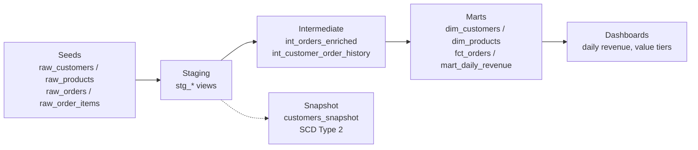

# dbt Transformation Models

Portfolio implementation based on production work experience. All data is
synthetic, all code is original and clean-room, and no proprietary code,
data, schema names, or internal system details from any employer are
included.

## The problem

Raw order, customer, and product tables arrive as flat extracts: prices in
cents, inconsistent status spellings, discounts that can exceed an order's
value, and no single place a dashboard can read revenue from. Every analyst
recomputes the same joins, the same currency conversion, and the same
"what counts as a completed order" rule, and every recomputation drifts.

## What it does

A dbt project that turns four raw retail tables into analytics-ready marts,
runnable end to end on a local DuckDB file with no warehouse:

- **Staging (views)** — one model per source: types cast, names and
  emails normalized, prices converted from cents to dollars, status
  spellings unified (`complete`/`done` become `completed`,
  `canceled` becomes `cancelled`), and invalid line items filtered out.
  Every model declares its materialization explicitly.
- **Intermediate (ephemeral)** — `int_orders_enriched` joins orders to
  their lines and products and rolls revenue, cost, profit, and discount
  up to one row per order; `int_customer_order_history` aggregates orders
  per customer, including a fulfilled-order count and average fulfilled
  order value. A discount is capped at gross revenue, so net revenue can
  never go negative, and the applied discount is kept as its own column
  so the cap is auditable.
- **Marts (tables)** — `dim_customers` with lifetime revenue, average
  fulfilled order value, and a value tier; `dim_products` with unit
  margin and margin percent; `fct_orders` with one row per fulfilled
  order (completed or shipped only) plus gross margin percent; and
  `mart_daily_revenue` for dashboards.
- **Tests** — 102 data tests: uniqueness, not-null, accepted values, and
  relationships on every key, plus 10 singular tests, including
  cross-model reconciliation (customer lifetime revenue matches the
  fact table, daily revenue matches the fact table, line counts match
  the line items, and every fact row's arithmetic holds). Source
  freshness is configured on the customer source.
- **Snapshot** — a timestamp-strategy snapshot of `stg_customers` keeps
  history as customer records change, the SCD Type 2 pattern used for
  slowly changing dimensions.
- **Macros** — `cents_to_dollars` (rounded to the cent),
  `order_status_label`, `capped_discount`, `value_tier`, and
  `fulfilled_statuses_list` hold the repeated logic in one place so
  every model applies the same rule.
- **Config in one place** — value-tier thresholds and the fulfilled
  status list live as vars in `dbt_project.yml`; no model hardcodes a
  threshold or a status list. The profile has dev and prod targets and
  no credentials; the database file is overridable with
  `DBT_DUCKDB_PATH`.
- **Docs and analyses** — shared definitions (`fulfilled_order`,
  `net_revenue`, `discount_applied`, `value_tier`) live as doc blocks
  in `docs/overview.md` and are referenced from the schema files; two
  analyses (`revenue_by_category`, `customer_value_segments`) compile
  but are never materialized.

The seed data is synthetic (200 customers, 40 products, 800 orders, 2,003
line items) and regenerates deterministically from
`scripts/generate_seeds.py`.

## Architecture — Before / After

### Before

Analysts queried the raw extracts directly. Revenue meant a different
thing in every query, discounts occasionally produced negative order
totals, and there was no tested definition of a fulfilled order.

### After

Raw data lands in `raw`, staging cleans it once, intermediate models hold
the shared business logic, and marts expose one tested definition of each
entity. A dashboard reads `mart_daily_revenue`; anything else reads a
dimension or a fact, never the raw tables.



<details>
<summary><b>Model flow — click to expand</b></summary>

<br>

1. **Seed:** `dbt seed` loads the four synthetic CSVs into the `raw` schema.
2. **Stage:** `stg_*` models cast types, convert cents to dollars, normalize
   status values, and filter invalid rows.
3. **Enrich:** `int_orders_enriched` joins lines to products for cost,
   rolls revenue/cost/profit per order, and caps the discount at gross
   revenue, keeping the applied discount visible.
4. **Aggregate:** `int_customer_order_history` rolls orders per customer
   for lifetime value, fulfilled-order count, and average order value.
5. **Mart:** dimensions and facts materialize as tables; `fct_orders`
   keeps fulfilled orders only, `mart_daily_revenue` rolls them by day.
6. **Snapshot:** `dbt snapshot` records customer changes over time.
7. **Test:** `dbt build` runs every generic and singular test; a failed
   test fails the build.

</details>

| Earlier issues | Risk | Impact after |
|---|---|---|
| Prices in cents, mixed types | Every query converts differently | One conversion macro, applied once in staging |
| Status spellings vary | "completed" counted differently per query | Statuses unified in `stg_orders` |
| Discount can exceed order value | Negative net revenue in reports | Discount capped at gross revenue |
| No tested definition of an order | Dashboards disagree on revenue | `fct_orders` is the single tested definition |
| Customer changes overwrite history | No way to see a customer as of a past date | Timestamp snapshot keeps SCD Type 2 history |
| No tests on raw data | Bad keys and broken joins surface downstream | Unique, not-null, relationship, and value tests on every key |
| Thresholds buried in SQL | Tier cuts drift between models | Tier thresholds and fulfilled statuses are vars in `dbt_project.yml` |

## Run

```bash
# Install dbt with the DuckDB adapter
pip install -r requirements.txt

# Load the synthetic seeds, then build everything and run all tests
dbt seed --profiles-dir .
dbt build --profiles-dir .

# Snapshot customer history and generate the docs site
dbt snapshot --profiles-dir .
dbt docs generate --profiles-dir .
dbt docs serve --profiles-dir .
```

No warehouse is needed: the default profile writes a local `dev.duckdb`
file. To use a different file without editing anything:

```bash
DBT_DUCKDB_PATH=/path/to/other.duckdb dbt seed --profiles-dir .
DBT_DUCKDB_PATH=/path/to/other.duckdb dbt build --profiles-dir .
```

The `prod` target (`--target prod`) is the same engine with a separate
file. To point the project at another warehouse, add a target to
`profiles.yml`.

## How to test

```bash
# Full dbt run: seeds, models, snapshot, and all 102 data tests
dbt build --profiles-dir .

# dbt tests only, against already-built models
dbt test --profiles-dir .

# Python tests (stdlib unittest, no extra dependencies): seed-file
# integrity, generator determinism, and project config rules
python -m unittest discover -s python_tests -v

# Compile the analyses without materializing them
dbt compile --profiles-dir . --select "resource_type:analysis"
```

Example output (`dbt build`):

```
Done. PASS=115 WARN=0 ERROR=0 SKIP=0 NO-OP=0 REUSED=0 TOTAL=115
```

Verified against the seed data (2026-11-24, dbt Core 1.12 /
dbt-duckdb 1.11, Python 3.12):

```
raw customers:    200      raw products:      40
raw orders:       800      raw order items: 2,003
dim_customers:    200      dim_products:      40
fct_orders:       530 fulfilled orders
mart_daily_revenue: 362 days
fct net revenue:  $219,221.24
value tiers:      95 high / 65 mid / 35 low / 5 never ordered
snapshot:         200 customer rows
python tests:     20 passed
```

## Files

- `dbt_project.yml` — project config: staging as views, intermediate as ephemeral, marts as tables, seeds into `raw`; business-rule vars (value-tier thresholds, fulfilled statuses)
- `profiles.yml` — local DuckDB profile, dev and prod targets, no credentials; path overridable with `DBT_DUCKDB_PATH`
- `models/sources.yml` — raw sources with freshness and key tests (no hardcoded database, so any DuckDB file works)
- `models/staging/stg_customers.sql`, `stg_products.sql`, `stg_orders.sql`, `stg_order_items.sql` — cleaned sources
- `models/staging/_staging.yml` — staging docs and tests
- `models/intermediate/int_orders_enriched.sql` — per-order revenue, cost, profit, capped discount, applied discount
- `models/intermediate/int_customer_order_history.sql` — per-customer order aggregates, fulfilled counts, average order value
- `models/intermediate/_intermediate.yml` — intermediate docs and tests
- `models/marts/dim_customers.sql`, `dim_products.sql`, `fct_orders.sql`, `mart_daily_revenue.sql` — analytics-ready tables
- `models/marts/_marts.yml` — mart docs and tests
- `macros/cents_to_dollars.sql` — cents-to-dollars conversion, rounded to the cent
- `macros/order_status_label.sql` — status spelling normalization
- `macros/capped_discount.sql` — discount capped at gross revenue, floored at zero
- `macros/value_tier.sql` — customer value tier from project vars
- `macros/fulfilled_statuses_list.sql` — fulfilled-status list rendered from project vars
- `macros/generate_schema_name.sql` — custom schemas used exactly as written
- `snapshots/customers_snapshot.sql` — timestamp-strategy snapshot of `stg_customers` (SCD Type 2)
- `seeds/raw_*.csv` — synthetic raw data (200 customers, 40 products, 800 orders, 2,003 items)
- `scripts/generate_seeds.py` — regenerates the seed CSVs deterministically
- `tests/assert_*.sql` — 10 singular tests (2 original, 8 added: discount and quantity guards, enriched-model guards, and cross-model reconciliation)
- `analyses/revenue_by_category.sql`, `customer_value_segments.sql` — compiled, never materialized
- `docs/overview.md` — shared doc blocks for fulfilled orders, net revenue, discounts, and value tiers
- `python_tests/test_generate_seeds.py`, `test_project_config.py` — 20 stdlib-unittest checks on seeds, determinism, and config rules
- `requirements.txt` — `dbt-duckdb`

## Deliberately left simple

- **No dbt packages.** No `dbt_utils` or other dependency: everything
  here is hand-written so the project installs with one package and
  nothing else to keep up to date.
- **No incremental models.** 800 orders fully refresh in seconds; an
  incremental strategy would add complexity with no benefit at this
  scale. The marts are plain tables.
- **DuckDB only.** The prod target is a second local DuckDB file, not a
  warehouse. Pointing the project at a real warehouse means a new
  profile target, not a rewrite, but it is not done here.
- **Date-granularity snapshot history.** The seed `updated_at` values
  are dates, so snapshot validity timestamps are date-granular. On a
  source with real timestamps the same snapshot works at full precision.
- **Illustrative thresholds.** The $1,000 / $250 value-tier cutoffs are
  arbitrary demo values in `dbt_project.yml`, not calibrated to any real
  business; change them with `--vars` or by editing the vars.
