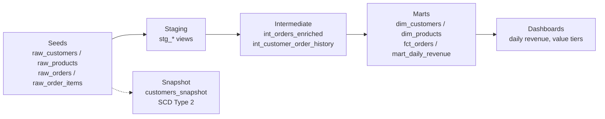

# dbt Transformation Models

Portfolio implementation based on production work experience. All data is
synthetic, all code is original and clean-room, and no proprietary code,
data, schema names, or internal system details from any employer are
included.

## The problem

Raw order, customer, and product tables arrive as flat extracts: prices in
cents, inconsistent status spellings, discounts that can exceed an order's
value, and no single place a dashboard can read revenue from. Every analyst
recomputes the same joins, the same currency conversion, and the same
"what counts as a completed order" rule, and every recomputation drifts.

## What it does

A dbt project that turns four raw retail tables into analytics-ready marts,
runnable end to end on a local DuckDB file with no warehouse:

- **Staging (views)** — one model per source: types cast, emails
  normalized, prices converted from cents to dollars, status spellings
  unified (`complete`/`done` become `completed`), and invalid line items
  filtered out.
- **Intermediate (ephemeral)** — `int_orders_enriched` joins orders to
  their lines and products and rolls revenue, cost, profit, and discount
  up to one row per order; `int_customer_order_history` aggregates orders
  per customer. A discount is capped at gross revenue, so net revenue can
  never go negative.
- **Marts (tables)** — `dim_customers` with lifetime revenue and a value
  tier, `dim_products` with unit margin, `fct_orders` with one row per
  fulfilled order (completed or shipped only), and `mart_daily_revenue`
  for dashboards.
- **Tests** — uniqueness, not-null, accepted values, and relationships on
  every key, plus two singular tests: fulfilled orders never have negative
  net revenue, and no product is priced below its cost. Source freshness
  is configured on the customer source.
- **Snapshot** — a timestamp-strategy snapshot of customers keeps
  history as customer records change, the SCD Type 2 pattern used for
  slowly changing dimensions.
- **Macros** — `cents_to_dollars` and `order_status_label` hold the
  repeated logic in one place so every model applies the same rule.

The seed data is synthetic (200 customers, 40 products, 800 orders, 2,003
line items) and regenerates deterministically from
`scripts/generate_seeds.py`.

## Architecture — Before / After

### Before

Analysts queried the raw extracts directly. Revenue meant a different
thing in every query, discounts occasionally produced negative order
totals, and there was no tested definition of a fulfilled order.

### After

Raw data lands in `raw`, staging cleans it once, intermediate models hold
the shared business logic, and marts expose one tested definition of each
entity. A dashboard reads `mart_daily_revenue`; anything else reads a
dimension or a fact, never the raw tables.



<details>
<summary><b>Model flow — click to expand</b></summary>

<br>

1. **Seed:** `dbt seed` loads the four synthetic CSVs into the `raw` schema.
2. **Stage:** `stg_*` models cast types, convert cents to dollars, normalize
   status values, and filter invalid rows.
3. **Enrich:** `int_orders_enriched` joins lines to products for cost,
   rolls revenue/cost/profit per order, and caps the discount at gross
   revenue.
4. **Aggregate:** `int_customer_order_history` rolls orders per customer
   for lifetime value.
5. **Mart:** dimensions and facts materialize as tables; `fct_orders`
   keeps fulfilled orders only, `mart_daily_revenue` rolls them by day.
6. **Snapshot:** `dbt snapshot` records customer changes over time.
7. **Test:** `dbt build` runs every generic and singular test; a failed
   test fails the build.

</details>

| Earlier issues | Risk | Impact after |
|---|---|---|
| Prices in cents, mixed types | Every query converts differently | One conversion macro, applied once in staging |
| Status spellings vary | "completed" counted differently per query | Statuses unified in `stg_orders` |
| Discount can exceed order value | Negative net revenue in reports | Discount capped at gross revenue |
| No tested definition of an order | Dashboards disagree on revenue | `fct_orders` is the single tested definition |
| Customer changes overwrite history | No way to see a customer as of a past date | Timestamp snapshot keeps SCD Type 2 history |
| No tests on raw data | Bad keys and broken joins surface downstream | Unique, not-null, relationship, and value tests on every key |

## Run

```bash
# Install dbt with the DuckDB adapter
pip install -r requirements.txt

# Load the synthetic seeds, then build everything and run all tests
dbt seed --profiles-dir .
dbt build --profiles-dir .

# Snapshot customer history and generate the docs site
dbt snapshot --profiles-dir .
dbt docs generate --profiles-dir .
dbt docs serve --profiles-dir .
```

No warehouse is needed: the default profile writes a local `dev.duckdb`
file. To point the project at another warehouse, add a target to
`profiles.yml`.

Example output (`dbt build`):

```
Done. PASS=55 WARN=0 ERROR=0 SKIP=0 NO-OP=0 REUSED=0 TOTAL=55
```

Verified against the seed data:

```
raw customers:    200      raw products:      40
raw orders:       800      raw order items: 2,003
dim_customers:    200      dim_products:      40
fct_orders:       530 fulfilled orders
mart_daily_revenue: 362 days
fct net revenue:  $219,221.24
value tiers:      95 high / 65 mid / 35 low / 5 never ordered
snapshot:         200 customer rows
```

## Files

- `dbt_project.yml` — project config: staging as views, intermediate as ephemeral, marts as tables, seeds into `raw`
- `profiles.yml` — local DuckDB profile (no warehouse needed)
- `models/sources.yml` — raw sources with freshness and key tests
- `models/staging/stg_customers.sql`, `stg_products.sql`, `stg_orders.sql`, `stg_order_items.sql` — cleaned sources
- `models/staging/_staging.yml` — staging docs and tests
- `models/intermediate/int_orders_enriched.sql` — per-order revenue, cost, profit, capped discount
- `models/intermediate/int_customer_order_history.sql` — per-customer order aggregates
- `models/intermediate/_intermediate.yml` — intermediate docs and tests
- `models/marts/dim_customers.sql`, `dim_products.sql`, `fct_orders.sql`, `mart_daily_revenue.sql` — analytics-ready tables
- `models/marts/_marts.yml` — mart docs and tests
- `macros/cents_to_dollars.sql` — cents-to-dollars conversion
- `macros/order_status_label.sql` — status spelling normalization
- `macros/generate_schema_name.sql` — custom schemas used exactly as written
- `snapshots/customers_snapshot.sql` — timestamp-strategy customer snapshot (SCD Type 2)
- `seeds/raw_*.csv` — synthetic raw data (200 customers, 40 products, 800 orders, 2,003 items)
- `scripts/generate_seeds.py` — regenerates the seed CSVs deterministically
- `tests/assert_fct_orders_revenue_positive.sql` — fulfilled orders never have negative net revenue
- `tests/assert_product_pricing.sql` — no product priced below cost
- `requirements.txt` — `dbt-duckdb`
